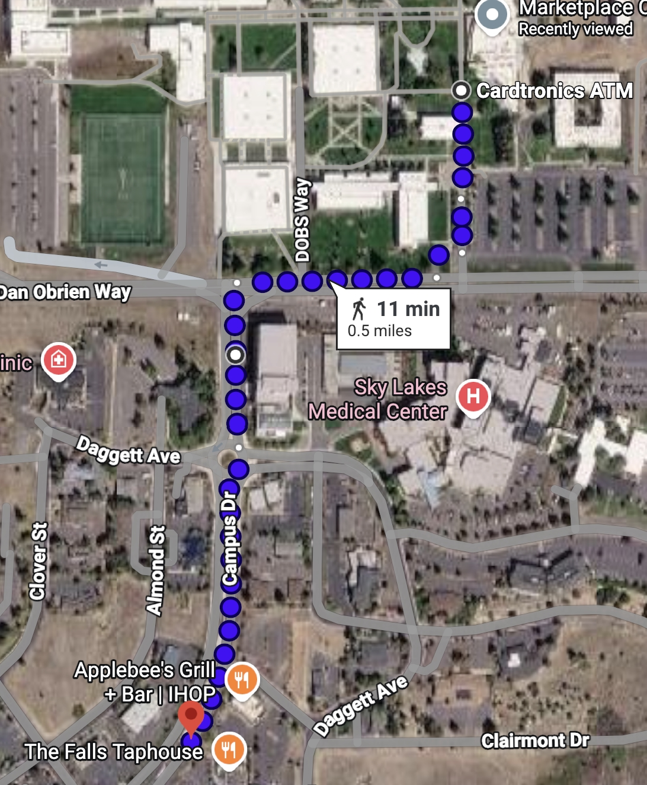
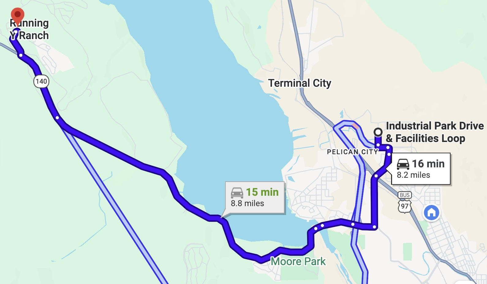

---
format:
  html:
    toc: false
    theme: cosmo
    format-links: false
---

# APS Northwest Section — 2026 Annual Meeting

**Oregon Institute of Technology · Klamath Falls, Oregon · June 4–6, 2026**

Welcome to the 2026 Annual Meeting of the APS Northwest Section! We are delighted to host you at OIT. Registration and the information desk are in the **Auditorium Lobby** (College Union, main floor).

---

[Schedule and abstracts in the APS meeting archive](https://meetings-archive.aps.org/nws/2026/)

---

### At a Glance

**Thursday, June 4**
— 4:00–5:00 p.m.: Registration, CU Auditorium Lobby
— 5:00 p.m.: Welcome Reception, The Falls Taphouse

**Friday, June 5** — OIT College Union, 8 a.m.–3:45 p.m.; banquet at Running Y Resort, 6 p.m.
— Breakfast · Plenary sessions · Lunch · Parallel contributed sessions · Banquet

**Saturday, June 6** — OIT College Union, 8 a.m.–3:30 p.m.
— Breakfast · Plenary sessions · Lunch & poster session · Contributed sessions · Closing remarks

## Schedule

### Thursday, June 4

| Time | Activity | Location |
|:-----|:---------|:---------|
| 4:00–5:00 p.m. | Registration | CU Auditorium Lobby |
| 5:00 p.m. | Welcome Reception | The Falls Taphouse |

---

### Friday, June 5 — OIT College Union

| Time | Activity | Location |
|:-----|:---------|:---------|
| 8:00 a.m. | Breakfast | Auditorium Lobby |
| 9:00 a.m. | **Plenary I** — Heath · Acres · Hart | Auditorium |
| 10:48 a.m. | Coffee Break | Auditorium Lobby |
| 11:05 a.m. | **Plenary II** — Oliver · Frey | Auditorium |
| 12:30 p.m. | Lunch | Crater Lake Complex |
| 2:00–2:45 p.m. | Condensed Matter | Auditorium |
| | Nuclear & Particle Physics | CLC Mt Scott |
| 2:45 p.m. | Coffee Break | Auditorium Lobby |
| 3:00–3:45 p.m. | Biophysics & Nonlinear Dynamics | Auditorium |
| | General Physics | CLC Mt Scott |
| 3:45 p.m. | *Adjourn; travel to Running Y Resort* | |
| 6:00 p.m. | Banquet Reception | Running Y Resort |
| 6:45 p.m. | Dinner & Keynote — Ginsberg | Running Y Resort |

---

### Saturday, June 6 — OIT College Union

| Time | Activity | Location |
|:-----|:---------|:---------|
| 8:00 a.m. | Breakfast | Auditorium Lobby |
| 9:00 a.m. | **Plenary III** — Murray · Baio · Coates | Auditorium |
| 10:48 a.m. | Coffee Break | Auditorium Lobby |
| 11:05 a.m. | **Plenary IV** — Mace · Vartanyan | Auditorium |
| 12:30 p.m. | Lunch & Poster Session | Crater Lake Complex |
| 2:00–2:30 p.m. | Astrophysics & Cosmology | Auditorium |
| 2:30–2:45 p.m. | Coffee Break | Auditorium Lobby |
| 2:45–3:30 p.m. | Nuclear & Radiation Physics | Auditorium |
| 3:30 p.m. | Closing Remarks | Auditorium |

## Venue and Meals

**Registration and information desk** — Auditorium Lobby, College Union main floor. Nametags and the LOC are here throughout the meeting.

**Crater Lake Complex** is directly up the stairs from the Auditorium Lobby. The poster session, Friday and Saturday lunches, and Friday's parallel session room (CLC Mt Scott) are all here.

---

### Welcome Reception — Thursday, June 4

5:00 p.m. · The Falls Taphouse
2215 Shallock Ave, Klamath Falls, OR 97601

A 10-minute walk from the College Union. Food and drink — including a large selection of local microbrews — are available for purchase. We'll be on the rooftop deck, weather permitting. *Walking map on page 5.*

---

### Meals

Breakfast (8:00–9:00 a.m.) and lunch (12:15 p.m.) are provided each day at the College Union. All coffee breaks include refreshments in the Auditorium Lobby.

Dietary needs noted at registration will be accommodated.

---

### Banquet & Keynote — Friday, June 5

6:00 p.m. reception · 6:45 p.m. dinner · Keynote to follow

Running Y Resort — Woodlands Ballroom
5500 Running Y Road, Klamath Falls, OR 97601
(541) 850-5500

**Keynote:** Matt Ginsberg (Google DeepMind)
*Physics and AI: Separating the Hype from the Reality*

About 9 miles from OIT, 15 minutes by car. Take OR-140 toward Medford; Running Y is on the right. Carpooling is encouraged. Banquet tickets are available at the registration desk. *Driving map on page 5.*

---

### Parking

OIT's campus is compact — no lot is more than a five-minute walk from the College Union.

**Avoid** lots A, B, C, P, and Q (reserved for students and faculty during the week). Look for **General Parking** signs, or use:

- **Lots E and F** — off Industrial Park Drive (large; usually plentiful)
- **Lots G and H** — near Cornett Hall (large; usually plentiful)

Parking will be tighter on Friday (last day of class for OIT students) and easy on Saturday.

## Campus Map

[View Campus Parking Map (PDF)](https://drive.google.com/file/d/1pUe2TGcg1fvqsT728_HAvy_ZxX9GRr23/view?usp=drive_link)

*(Download the PDF for the full-page map with lot labels.)*

## Directions

**Walking to The Falls Taphouse** *(10 minutes from the College Union)*

{width=4in}

**Driving to Running Y Resort** *(9 miles via OR-140, about 15 minutes)*

{width=5in}
